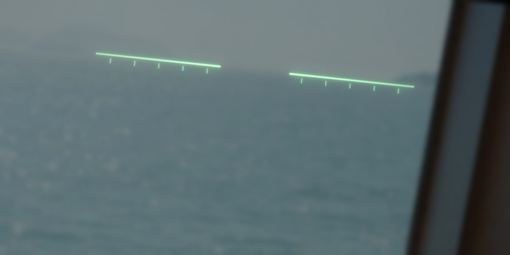
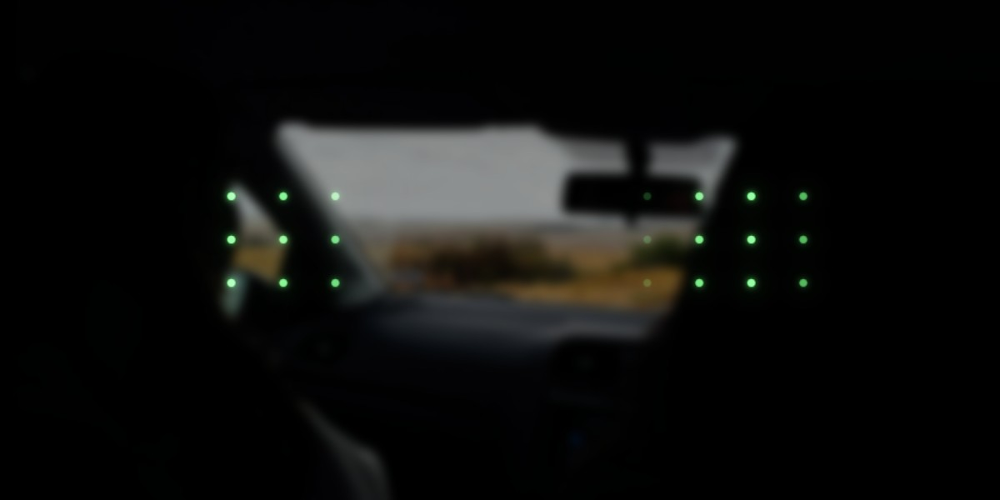

# Levelhead

An attempt to reduce motion sickness in moments of need, on Even Realities G2 glasses. This is a PoC.

> [!CAUTION]
> Not a medical device. Use at your own risk. Never use while driving.

| Ship | Car |
| :---: | :---: |
|  |  |
| A line that stays level with the horizon | Dots that move with each turn and brake |

<sub>Simulated views. Photos by Zhen Yao and Adrien Olichon on Unsplash.</sub>

## Run

```bash
npm install
npm run dev
npm run sim:demo
```

## More

How it works and what it is based on: [docs/notes.md](docs/notes.md)
